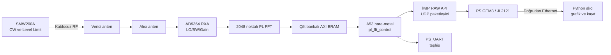

# AXU4EVB-P + AD9364 Bare-Metal UDP FFT Tasarımı

Tarih: 31 Temmuz 2026

Durum: Onaylanmış tasarım

Uygulama durumu (31 Temmuz 2026): Protokol, sürekli servis, lwIP/GEM3 taşıyıcısı,
ayrı Vitis Ethernet build'i ve Python viewer uygulanmıştır. 38 host testi ve
gerçek Release ELF build'i geçmiştir. USB-Ethernet adaptörü bulunmadığından
fiziksel ping, gerçek UDP capture, soak ve kablosuz CW kabulü beklemektedir.
Fiziksel PASS veya nihai Candidate iddiası yoktur.

Hedef platform: AXU4EVB-P + AD-FMCOMMS3-EBZ üzerindeki AD9364

Araç zinciri: Vivado/Vitis 2020.1, bare-metal A53

## 1. Amaç

Bu tasarım, mevcut ve kart üzerinde doğrulanmış 2048-bin PL FFT çıktısını
PetaLinux kullanmadan AXU4EVB-P kartının PS GEM3 Ethernet arabirimi üzerinden
bir Windows bilgisayardaki Python uygulamasına aktarmayı tanımlar.

RF kabul testi, Rohde & Schwarz SMW200A sinyal jeneratöründen çıkan sınırlı
seviyeli CW sinyalinin antenler üzerinden kablosuz olarak AD9364 RXA girişine
ulaştırılmasıyla yapılacaktır. JTAG kartı başlatmak, PS_UART ise açılış ve hata
teşhisi için kullanılmaya devam edecektir.

## 2. Tasarım ilkeleri

- Çalışan `vitis2` workspace'i değiştirilmez.
- `monopulse-live-lab-v2` ve daha eski Candidate paketleri değiştirilmez.
- Ethernet çalışması ayrı `vitis_ethernet` workspace'inde yürütülür.
- Başarılı sonuç yeni `monopulse-live-ethernet-v1` Candidate paketi olarak
  yayımlanır.
- Mevcut doğrulanmış PL bitstream, XSA, FFT capture ve RF yapılandırması aynen
  kullanılır; bu Candidate için yeni Vivado implementasyonu üretilmez.
- İlk sürüm yalnız FFT verisi gönderir; Ethernet üzerinden RF kazancı,
  frekansı veya jeneratör seviyesi değiştirilmez.
- İlk sürümde ham I/Q verisi, TCP, DHCP, yeniden gönderim ve uzaktan firmware
  güncelleme kapsam dışıdır.

## 3. Mevcut durumun doğrulanması

Güncel XSA ve BSP çıktılarında aşağıdaki kaynaklar mevcuttur:

- PS GEM3 etkin.
- Ethernet veri MIO'ları: MIO 64..75.
- MDIO: MIO 76..77.
- GEM3 referans saati: 125 MHz.
- Vitis BSP görünümü: `XPAR_XEMACPS_0_BASEADDR = 0xFF0E0000`.
- Harici Ethernet PHY: JL2121.
- PL FFT boyutu: 2048.
- Spektrum sözcüğü: unsigned 64 bit.
- Bir FFT karesi: 16.384 bayt.
- Mevcut RF çalışma noktası:
  - RX portu: RXA / channel 0 / A_BALANCED
  - LO: 2.400000 GHz
  - sample rate: 30.72 MSPS
  - bant genişliği: 10 MHz
  - kazanç modu: manual
  - kazanç: 50 dB
  - bin aralığı: 15 kHz

Donanımda GEM3 bulunduğu için ilk tasarım Vivado veya bitstream değişikliği
öngörmez. JL2121 PHY'nin lwIP sürücüsüyle otomatik anlaşması ayrı bir kabul
kapısıdır.

## 4. Değerlendirilen taşıma yöntemleri

### 4.1 Sürekli UDP unicast

Kart, hedef bilgisayara sabit hızda FFT kareleri gönderir. Düşük gecikme,
küçük kod yüzeyi ve paket kaybı halinde sistemin bloke olmaması nedeniyle
seçilmiştir.

### 4.2 UDP istek-yanıt

Bilgisayar her FFT karesini komutla ister. Daha kontrollüdür ancak çift yönlü
komut protokolü, zaman aşımı ve istek tekrarları gerektirir. İlk sürüm için
gereksiz karmaşıklık oluşturur.

### 4.3 TCP akışı

Taşıma güvenilirliği sağlar ancak bağlantı durumu, yeniden bağlanma,
head-of-line gecikmesi ve buffer yönetimini firmware'e taşır. Mevcut düşük
bant genişliği için gerekli değildir.

Karar: İlk sürüm sürekli UDP unicast kullanacaktır.

## 5. Sistem mimarisi



### 5.1 Ağ yapılandırması

| Bileşen | Değer |
|---|---:|
| Kart IPv4 adresi | `192.168.1.10` |
| Bilgisayar IPv4 adresi | `192.168.1.100` |
| Ağ maskesi | `255.255.255.0` |
| Gateway | `0.0.0.0` |
| UDP hedef portu | `5005` |
| Hedef kare hızı | 4 frame/s |
| Kare aralığı | 250 ms |
| Ethernet bağlantısı | Doğrudan kart-bilgisayar |

DHCP kullanılmayacaktır. Bilgisayarın ilgili Ethernet adaptörüne sabit adres
verilecektir.

## 6. Firmware bileşenleri

### 6.1 Değişmeden kullanılacak bileşenler

- AD9364 başlatma ve RF çalışma noktası.
- `pl_fft_control.c/.h`.
- PL FFT AXI-Lite kontrol kayıtları.
- Çift bankalı spektrum BRAM erişimi.
- FFT frame ID, peak, flag ve CRC doğrulamaları.

### 6.2 Yeni bileşenler

`fft_udp_protocol.h`

- Wire-format sabitleri ve paket başlığı.
- Protokol sürümü.
- Flag ve hata kodları.
- Host/network endian yardımcıları.

`fft_udp_transport.c/.h`

- lwIP RAW API başlatma.
- Statik IPv4 ve GEM3 kurulumu.
- Link/PHY kontrolü.
- FFT karesini UDP parçalarına bölme.
- Gönderim ve drop sayaçları.

Ethernet uygulama modu

- Ayrı bir compiler sembolüyle seçilir.
- AD9364 ve FFT başlatıldıktan sonra Ethernet linkini bekler.
- Her 250 ms'de bir tutarlı FFT snapshot'ı alır.
- RF telemetrisini doğrular ve kareyi UDP ile gönderir.
- lwIP girişini ve zamanlayıcılarını ana döngüde düzenli işler.

## 7. UDP wire protokolü

### 7.1 Genel kurallar

- Protokol sürümü: 1.
- Paket tipi: FFT data.
- Ethernet MTU: 1500 bayt.
- IPv4 başlığı: 20 bayt.
- UDP başlığı: 8 bayt.
- Uygulama başlığı: 64 bayt.
- Bir pakette en fazla 1408 bayt spektrum verisi bulunur.
- Bir tam paket 176 adet 64-bit FFT bin'i taşır.
- Bir 2048-bin kare 12 UDP paketine bölünür.
- Son paket 112 bin taşır.
- Uygulama başlığındaki sayısal alanlar network byte order kullanır.
- Spektrum payload'ı mevcut PL/UART CRC sözleşmesini korumak için unsigned
  64-bit little-endian sözcüklerden oluşur.

### 7.2 64 baytlık paket başlığı

| Alan | Tür | Açıklama |
|---|---:|---|
| `magic` | `uint32` | `0x41464654`, ASCII `AFFT` |
| `version` | `uint8` | Protokol sürümü, ilk sürümde 1 |
| `packet_type` | `uint8` | FFT data için 1 |
| `header_bytes` | `uint16` | 64 |
| `frame_id` | `uint32` | PL FFT frame numarası |
| `chunk_index` | `uint16` | 0..11 |
| `chunk_count` | `uint16` | 12 |
| `first_bin` | `uint16` | Payload'ın ilk FFT bin'i |
| `bin_count` | `uint16` | Bu paketteki bin sayısı |
| `fft_size` | `uint16` | 2048 |
| `flags` | `uint16` | Donanım durum bitleri |
| `lo_hz` | `uint64` | AD9364 RX LO |
| `sample_rate_hz` | `uint32` | 30.720.000 |
| `bandwidth_hz` | `uint32` | 10.000.000 |
| `gain_db` | `int16` | İlk Candidate için 50 |
| `peak_bin` | `uint16` | Natural-order peak bin |
| `peak_power` | `uint64` | Kalibre edilmemiş FFT peak gücü |
| `frame_crc32` | `uint32` | PL FFT karesinin CRC-32 değeri |
| `peak_re` | `int16` | Peak bin gerçek bileşeni |
| `peak_im` | `int16` | Peak bin sanal bileşeni |
| `reset_epoch` | `uint16` | PL FFT reset dönemi |
| `rf_state` | `uint8` | RF switch durumu, ilk Candidate için 0 |
| `active_bank` | `uint8` | Okunan çift-buffer bankı, 0 veya 1 |

UDP checksum taşıma hatasını, `frame_crc32` ise yeniden oluşturulan FFT
karesinin PL tarafından yayımlanan kareyle aynı olduğunu denetler.

## 8. Python uygulaması

Yeni uygulama `PROJECT/ethernet_fft` altında bağımsız tutulacaktır:

```text
PROJECT/ethernet_fft/
├── protocol.py
├── receiver.py
├── plotter.py
├── storage.py
└── requirements.txt
```

Sorumluluklar:

1. `0.0.0.0:5005` üzerinde UDP dinlemek.
2. Paket başlığını magic, sürüm ve boyut açısından doğrulamak.
3. Paketleri `frame_id` ile gruplamak.
4. `chunk_index`, `first_bin` ve `bin_count` tutarlılığını denetlemek.
5. On iki parça tamamlandığında 2048-bin spektrumu yeniden oluşturmak.
6. Frame CRC'yi doğrulamak.
7. Peak bin, frekans ofseti ve kalibre edilmemiş göreli gücü göstermek.
8. Varsayılan olarak kullanıcı durdurana kadar kesintisiz çalışmak.
9. `Ctrl+C` ile durdurulduğunda tamamlanmış frame'leri güvenli biçimde
   sonlandırmak ve seçilmişse NPZ, CSV ve JSON metadata üretmek.
10. Otomatik kabul testi için isteğe bağlı `--frames 100` sınırını desteklemek.
11. Kayıp paket, eksik frame, CRC hatası ve sıra atlamalarını saymak.

Eksik bir frame, ilk paketi alındıktan bir saniye sonra tamamlanmadıysa
atılır. Aynı frame/chunk tekrar gelirse ilk geçerli paket korunur ve tekrar
sayacı artırılır.

## 9. Hata yönetimi

| Durum | Firmware davranışı | Python davranışı |
|---|---|---|
| Ethernet link yok | `ETH: WAIT_LINK`, periyodik tekrar | Dinlemeye devam |
| PHY tanınmıyor | `ETH: FAIL stage=PHY`, FFT yayını başlatma | Bağlantı yok uyarısı |
| FFT capture hatası | Frame gönderilmez, capture hata sayacı artırılır | Frame beklemeye devam |
| Fatal PL flag | Frame gönderilmez, UART'ta ayrıntılı hata yazılır | Hata sayacında göster |
| lwIP/pbuf yetersiz | Frame'i atla, sistemi bloke etme | Sequence gap kaydet |
| Eksik UDP frame | Sonraki frame'lere devam | Bir saniye sonra frame'i at |
| CRC uyuşmazlığı | Gönderim sürer | Frame'i çizme/kaydetme |
| UDP alıcısı kapalı | Firmware çalışmaya devam eder | Uygulama tekrar açılabilir |

UART aşağıdaki durumları açıkça raporlar:

```text
ETH: INIT
ETH: PHY id=... addr=...
ETH: WAIT_LINK
ETH: LINK speed=... duplex=...
ETH: READY ip=192.168.1.10 target=192.168.1.100:5005
ETH_FFT: FRAME id=... peak_bin=... sent=12 dropped=...
ETH: FAIL stage=... error=...
```

## 10. RF güvenlik sınırları

Kablosuz RF yolu:

```text
SMW200A RF OUT A → verici anten → hava → alıcı anten → AD9364 RXA
```

Zorunlu sınırlar:

| Parametre | Değer |
|---|---:|
| SMW200A Level Limit | `-20 dBm` |
| İlk RF seviyesi | `-70 dBm` |
| Artırma adımı | `5 dB` |
| Normal deney üst sınırı | `-30 dBm` |
| Antenler arası mesafe | En az 1 metre |
| İlk CW frekansı | `2.400300 GHz` |
| Beklenen FFT peak | `bin 20 ±1` |

- Level Limit, RF çıkışı açılmadan önce ayarlanır.
- Anten bağlantıları RF çıkışı kapalıyken yapılır.
- Yazılım jeneratör seviyesini kontrol etmez.
- FFT gücü kalibre edilene kadar dBm olarak raporlanmaz.
- AD9364 clipping koruması yalnız FFT grafiğine bırakılmaz; güvenlik
  jeneratör limiti, düşük başlangıç seviyesi ve fiziksel mesafeyle sağlanır.

## 11. Doğrulama planı

### 11.1 Protokol birim testleri

- 2048-bin bilinen spektrumu paketleme ve yeniden birleştirme.
- Paketlerin karışık sırada gelmesi.
- Eksik chunk.
- Tekrarlanan chunk.
- Yanlış magic/sürüm/uzunluk.
- Yanlış CRC.
- Frame zaman aşımı.
- Frame ID sıra atlaması.

### 11.2 Firmware derleme ve izolasyon kontrolü

- Yeni `vitis_ethernet` workspace'i sıfırdan üretilebilir olmalıdır.
- BSP, lwIP RAW API ile derlenmelidir.
- Mevcut `vitis2` dosyalarının Git içerikleri değişmemelidir.
- Mevcut Candidate manifest, ELF ve bitstream SHA-256 değerleri değişmemelidir.

### 11.3 PHY/link kabulü

- Doğrudan Ethernet kablosu takılır.
- Bilgisayar adresi `192.168.1.100/24` yapılır.
- UART'ta JL2121 PHY adresi/ID ve link hızı görülür.
- Kart `192.168.1.10` adresinde ARP/ping seviyesinde erişilebilir olur.

### 11.4 Yapay spektrum aktarımı

- Firmware bilinen bir test spektrumu gönderir.
- Bilinen peak bin ve CRC Python tarafında aynı bulunur.
- Bu aşama RF ve PL FFT'den bağımsız olarak UDP yolunu doğrular.

### 11.5 Gerçek PL FFT aktarımı

- Jeneratör kapalıyken ortam gürültüsü spektrumu çizilir.
- Frame ID ilerler.
- Peak, CRC ve RF telemetrisi paket başlığıyla uyumludur.

### 11.6 Kablosuz CW kabulü

- SMW200A güvenlik sınırları uygulanır.
- `2.400300 GHz` CW verilir.
- Seviye `-70 dBm` değerinden gerektiği kadar 5 dB adımlarla artırılır.
- `bin 20 ±1` peak görülür.

### 11.7 100-frame güvenilirlik kabulü

- Bu test çalışma zamanını 100 frame ile sınırlamaz; kesintisiz yayın içinden
  alınan sonlu ve tekrarlanabilir bir kabul penceresidir.
- 100 eksiksiz frame kaydedilir.
- CRC/protokol hatası sıfırdır.
- Doğrudan bağlantıda eksik frame hedefi sıfırdır.
- Frame'lerin en az yüzde 95'inde peak `bin 20 ±1` aralığındadır.
- NPZ, CSV ve JSON metadata dosyaları oluşturulur.
- Kanıt dosyalarının SHA-256 değerleri raporlanır.

## 12. Candidate yayınlama koşulları

`monopulse-live-ethernet-v1` yalnız aşağıdaki koşullarda oluşturulur:

1. Firmware ve Python testleri geçer.
2. PHY/link kabulü geçer.
3. Yapay spektrum testi geçer.
4. Gerçek PL FFT Ethernet üzerinden görüntülenir.
5. 100-frame kablosuz CW kabulü geçer.
6. Candidate içine yalnız doğrulanmış ELF, mevcut doğrulanmış bitstream/XSA,
   PMUFW, başlatıcı, README ve manifest alınır.
7. Tüm ikili dosyaların SHA-256 değerleri manifestte bulunur.

## 13. Geri dönüş ve regresyon

Ethernet Candidate başarısız olduğunda veya laboratuvarda UART doğrulamasına
ihtiyaç duyulduğunda mevcut `monopulse-live-lab-v2` başlatıcısı kullanılmaya
devam eder. Yeni workspace ve Candidate, mevcut çalışma yolunu değiştirmez.
Ethernet geliştirmesi hiçbir hazır Candidate dosyasının üzerine yazmaz.
